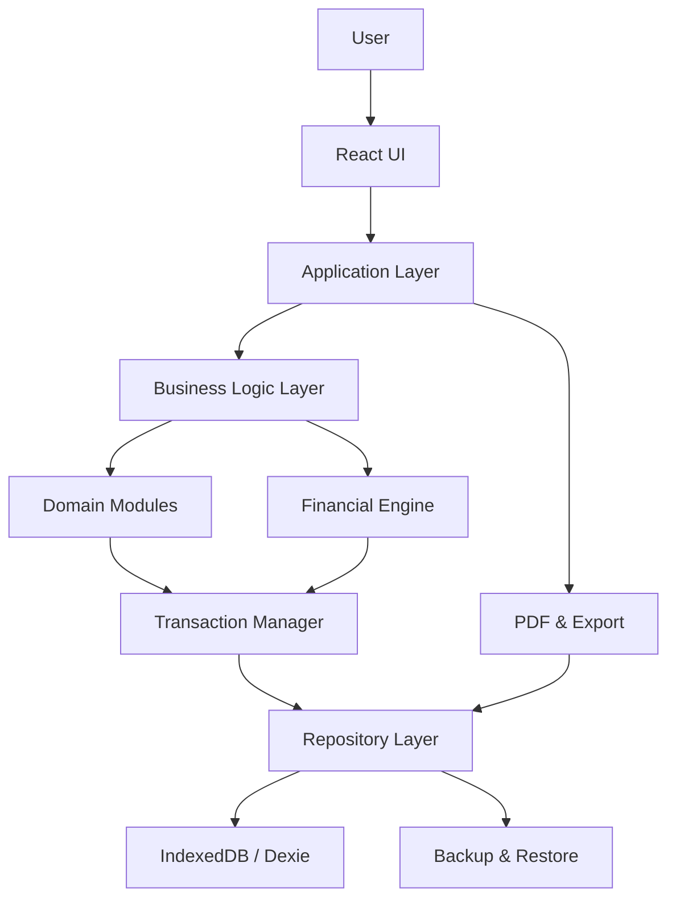

# ARCHITECTURE
## UMKM Manager

**Version:** 1.0  
**Status:** Draft – Proposed Architecture  
**Target:** UMKM Manager V1  
**Architecture Style:** Modular Monolith, Local-First, Offline-First

---

# 1. Tujuan Arsitektur

Dokumen ini menentukan struktur teknis UMKM Manager agar:

1. Aplikasi dapat berjalan tanpa internet.
2. Data utama tersimpan pada perangkat pengguna.
3. Tidak membutuhkan akun atau login.
4. Setiap fitur dapat diaktifkan dan dinonaktifkan.
5. Penambahan modul tidak merusak modul yang sudah ada.
6. Transaksi keuangan dan persediaan konsisten.
7. Data dapat dicadangkan dan dipulihkan.
8. Aplikasi dapat dikembangkan secara bertahap.

Arsitektur harus mengutamakan keandalan data dibandingkan kompleksitas teknologi.

# 2. Prinsip Arsitektur

## 2.1 Local-First

Perangkat pengguna menjadi tempat penyimpanan data utama.

Tidak ada ketergantungan pada server eksternal untuk:
- Membuka aplikasi.
- Melihat dashboard.
- Mencatat transaksi.
- Mengelola produk.
- Mengelola pelanggan.
- Melihat laporan.
- Membuat nota PDF.

## 2.2 Offline-First

Semua fungsi inti harus tetap bekerja ketika internet tidak tersedia.

Fungsi yang membutuhkan internet hanya bersifat tambahan, misalnya:
- Membagikan nota melalui layanan eksternal.
- Memperbarui aplikasi.
- Mengunduh pembaruan.

## 2.3 Modular Monolith

V1 menggunakan satu aplikasi dengan pemisahan modul secara internal.

Tidak menggunakan microservices.

Keuntungannya:
- Lebih sederhana untuk dikembangkan.
- Lebih mudah diuji.
- Tidak memerlukan infrastruktur server.
- Transaksi antarmodul dapat dikelola secara lokal.

## 2.4 Financial Integrity First

Semua operasi keuangan harus melewati service keuangan yang terpusat.

Komponen UI tidak boleh menghitung atau mengubah saldo secara langsung.

## 2.5 Data Preservation

Menonaktifkan fitur tidak boleh menghapus data historis.

Penghapusan permanen data transaksi tidak diperbolehkan melalui operasi biasa.

---

# 3. Teknologi yang Diusulkan

| Komponen | Teknologi |
|---|---|
| UI | Hasil desain/prototipe Lovable |
| Frontend | React |
| Language | TypeScript |
| Styling | Mengikuti desain Lovable |
| Build Tool | Vite |
| Local Database | IndexedDB |
| Database Wrapper | Dexie.js |
| PWA | Service Worker |
| Offline Cache | Cache Storage |
| PDF | Library PDF yang mendukung browser |
| Testing | Vitest |
| E2E Testing | Playwright |
| Validation | Zod atau alternatif setara |

**Catatan:** Teknologi ini merupakan rekomendasi awal, bukan izin untuk mengganti teknologi yang sudah digunakan dalam proyek Lovable. OpenCode harus memeriksa struktur dan dependensi aktual sebelum implementasi.

Tidak ada backend, cloud database, autentikasi, AI, atau sinkronisasi otomatis pada V1.

---

# 4. High-Level Architecture



## 4.1 UI Layer

Bertanggung jawab atas:
- Tampilan halaman.
- Form input.
- Navigasi.
- Dialog konfirmasi.
- Status transaksi.
- Penyajian laporan.

UI tidak boleh:
- Mengubah saldo secara langsung.
- Menghitung HPP sendiri.
- Mengurangi stok secara langsung.
- Mengubah status pembayaran tanpa service.
- Menulis data transaksi langsung ke database.

## 4.2 Application Layer

Mengelola perintah dan alur penggunaan.

Contoh:
- CreateSale.
- CreateOrder.
- RecordPayment.
- ReceiveStock.
- RecordExpense.
- CreateInvoice.
- RestoreBackup.

Application Layer memanggil business service yang sesuai.

## 4.3 Domain Layer

Berisi aturan inti bisnis:
- Finance.
- Sales.
- Inventory.
- Customers.
- Orders.
- Payments.
- Receivables.
- Payables.
- Payroll.
- Reporting.

Aturan bisnis harus dapat diuji tanpa menjalankan komponen UI.

## 4.4 Infrastructure Layer

Mengelola:
- IndexedDB.
- Repository.
- Database transaction.
- Backup.
- Restore.
- PDF generation.
- File export.
- Local application settings.

---

# 5. Modul Sistem

## 5.1 Core Modules

Modul yang menjadi fondasi aplikasi dan selalu tersedia:

- Business Profile.
- Dashboard.
- Finance Core.
- Transaction Engine.
- Settings.
- Feature Registry.
- Database.
- Backup & Restore.

Core Modules tidak dapat dinonaktifkan melalui menu pengguna.

## 5.2 Optional Modules

| Modul | Fungsi |
|---|---|
| Products | Data produk |
| Inventory | Persediaan |
| Sales | Penjualan |
| Customers | Pelanggan |
| Orders | Pesanan |
| Digital Invoices | Nota digital |
| Receivables | Piutang |
| Suppliers | Pemasok |
| Payables | Utang |
| Employees | Karyawan |
| Payroll | Penggajian |
| Budget | Anggaran |
| Savings Goals | Target tabungan |
| Business Assets | Aset usaha |
| Advanced Reports | Laporan lanjutan |

Setiap modul harus mempunyai:
- Module ID.
- Nama.
- Versi.
- Status aktif/nonaktif.
- Daftar dependensi.
- Daftar service yang disediakan.
- Daftar service yang dibutuhkan.

---

# 6. Feature Registry

Feature Registry mengelola modul yang diaktifkan pengguna.

Contoh:

```ts
interface FeatureDefinition {
  id: string;
  name: string;
  version: number;
  enabled: boolean;
  dependencies: string[];
}
```

Contoh konfigurasi:

```ts
const enabledFeatures = {
  products: true,
  inventory: true,
  sales: true,
  customers: true,
  orders: false,
  invoices: false,
  receivables: false,
  payroll: false
};
```

Aturan:
1. Modul hanya dapat diakses jika aktif.
2. Dependensi wajib harus diperiksa sebelum aktivasi.
3. Modul yang masih memiliki dependensi aktif tidak boleh dinonaktifkan tanpa konfirmasi dan penanganan dependensi.
4. Menonaktifkan modul tidak menghapus data.
5. Mengaktifkan kembali modul harus memulihkan akses ke data sebelumnya.
6. Riwayat transaksi lama tetap dapat dibaca meskipun modul terkait dinonaktifkan.
7. Modul inti tidak dapat dinonaktifkan.

---

# 7. Domain Service Architecture

Setiap domain memiliki service dan repository sendiri.

Contoh:

```text
Finance
  FinanceService
  FinanceRepository
  FinanceValidator

Sales
  SalesService
  SalesRepository
  SalesValidator

Inventory
  InventoryService
  InventoryRepository
  InventoryValidator

Customers
  CustomerService
  CustomerRepository
  CustomerValidator

Orders
  OrderService
  OrderRepository
  OrderValidator

Payments
  PaymentService
  PaymentRepository
  PaymentValidator
```

Service tidak boleh bergantung pada komponen React.

Repository bertanggung jawab atas akses data, bukan aturan bisnis.

---

# 8. Transaction Engine

Transaction Engine adalah komponen penting untuk menjaga konsistensi transaksi.

Contoh alur penjualan:

```text
User submits sale
       |
       v
Validate input
       |
       v
Check product and stock
       |
       v
Calculate sale and HPP
       |
       v
Start database transaction
       |
       v
Create sale record
       |
       v
Create sale items
       |
       v
Create payment or receivable
       |
       v
Update inventory movement
       |
       v
Create financial journal/events
       |
       v
Commit database transaction
       |
       v
Return success
```

Jika salah satu proses gagal:
- Semua perubahan dalam transaksi tersebut dibatalkan.
- Tidak boleh ada stok yang sudah berkurang tetapi penjualan tidak tersimpan.
- Tidak boleh ada pembayaran yang tersimpan tanpa referensi transaksi.
- Tidak boleh ada perubahan saldo sebagian.

## 8.1 Idempotency

Setiap perintah yang berpotensi dikirim ulang harus memiliki operation ID atau idempotency key.

Tujuannya:
- Mencegah transaksi ganda.
- Mencegah pembayaran ganda.
- Mencegah pengurangan stok berulang.
- Mencegah pesanan dikonversi menjadi penjualan lebih dari sekali.

## 8.2 Transaction Boundary

Operasi yang mengubah beberapa data terkait harus menggunakan satu transaksi database jika memungkinkan.

Jika operasi terlalu panjang untuk satu transaksi, sistem harus memiliki mekanisme pemulihan dan status yang jelas. Jangan mengklaim atomicity jika proses sebenarnya tidak atomik.

---

# 9. Financial Engine

Financial Engine menjadi pusat perhitungan keuangan.

Tanggung jawab:
- Saldo kas dan bank.
- Pendapatan.
- Beban.
- Modal.
- Pengambilan pemilik.
- Piutang.
- Utang.
- HPP.
- Laba kotor.
- Laba bersih.
- Rekonsiliasi.

Semua modul yang berdampak terhadap keuangan harus menggunakan Financial Engine.

Contoh:

```text
Sales Service
      |
      v
Financial Engine
      |
      v
Transaction Ledger
      |
      v
Reports
```

Aturan:
- Pembayaran piutang tidak membuat pendapatan baru.
- Pembayaran utang tidak membuat beban baru jika beban atau persediaan sudah diakui sebelumnya.
- Modal bukan pendapatan.
- Pengambilan pemilik bukan beban operasional.
- Transfer internal bukan pendapatan atau beban.
- Kas bukan indikator laba.
- Perhitungan tidak boleh mengarang nilai yang tidak tersedia.

**Keputusan penting yang belum final:** model pencatatan keuangan apakah menggunakan full double-entry accounting atau transaction/event ledger yang memiliki aturan debit-kredit dan rekonsiliasi. Arsitektur final dan database harus mengikuti keputusan yang disetujui, bukan asumsi implementer.

---

# 10. Inventory Engine

Inventory Engine mengelola:
- Penerimaan stok.
- Pengeluaran stok.
- Penjualan.
- Retur.
- Penyesuaian.
- Biaya perolehan.
- HPP.
- Riwayat pergerakan stok.

Setiap perubahan stok harus menghasilkan inventory movement yang dapat ditelusuri.

Contoh:

```text
PURCHASE_RECEIPT
SALE_ISSUE
SALES_RETURN
PURCHASE_RETURN
STOCK_ADJUSTMENT
DAMAGED_STOCK
```

Stok saat ini harus dapat direkonsiliasi dengan:
- Stok awal.
- Total penerimaan.
- Total pengeluaran.
- Retur.
- Penyesuaian.

Metode HPP harus mengikuti keputusan resmi pada FINANCIAL_LOGIC.md.

---

# 11. Local Database Architecture

Database utama menggunakan IndexedDB.

Dexie.js digunakan sebagai lapisan abstraksi database jika hasil pemeriksaan proyek mengonfirmasi kesesuaiannya.

Repository menjadi satu-satunya jalur akses database dari domain service.

Tidak boleh ada komponen UI yang langsung mengubah tabel database.

Data transaksi penting harus mempunyai:
- ID unik.
- Tanggal transaksi.
- Waktu pencatatan.
- Status.
- Referensi sumber transaksi.
- Created At.
- Updated At.
- Riwayat koreksi jika relevan.

---

# 12. Offline Architecture

Service Worker mengelola cache aset aplikasi.

IndexedDB menyimpan data bisnis.

Perbedaan tanggung jawab:

| Teknologi | Fungsi |
|---|---|
| IndexedDB | Data usaha |
| Cache Storage | Aset aplikasi |
| Service Worker | Pengelolaan cache dan akses offline |
| Browser Storage | Pengaturan lokal tertentu |

Jangan menyimpan data transaksi utama hanya di Cache Storage atau localStorage.

Aplikasi harus tetap dapat digunakan tanpa internet setelah instalasi dan pemuatan awal yang berhasil.

---

# 13. Backup & Restore Architecture

Backup harus mencakup:
- Profil usaha.
- Konfigurasi fitur.
- Produk.
- Pelanggan.
- Pemasok.
- Pesanan.
- Penjualan.
- Pembayaran.
- Piutang dan utang.
- Persediaan.
- Penggajian.
- Catatan keuangan.
- Metadata dan histori penting.

Backup harus memiliki:
- Format version.
- Application version.
- Database schema version.
- Created At.
- Integrity checksum.
- Metadata usaha.

Restore harus:
1. Memeriksa format.
2. Memeriksa versi.
3. Memvalidasi isi.
4. Memeriksa integritas.
5. Memastikan pengguna memahami efek restore.
6. Membuat perlindungan terhadap data saat ini.
7. Melakukan pemulihan secara aman.
8. Memeriksa hasil setelah restore.

---

# 14. PDF & Export Architecture

PDF dan ekspor harus menggunakan data dari service/repository.

PDF nota tidak boleh menjadi sumber data transaksi utama.

Ekspor yang direncanakan:
- PDF nota.
- PDF laporan.
- CSV.
- XLSX jika dibutuhkan.
- JSON backup.

Pembuatan PDF nota harus bekerja offline.

---

# 15. Reporting Architecture

Reporting Service mengambil data dari sumber transaksi yang sudah tersimpan.

Laporan tidak boleh mengubah transaksi.

Laporan meliputi:
- Penjualan.
- Pendapatan.
- Beban.
- Laba rugi.
- Arus kas.
- Piutang.
- Utang.
- Persediaan.
- HPP.
- Penggajian.

Laporan harus menampilkan batasan data jika ada informasi yang belum tersedia.

Contoh:
Jika pengguna tidak mencatat HPP, sistem tidak boleh menampilkan laba bersih seolah-olah akurat.

---

# 16. Error Handling

Error harus ditangani secara terstruktur.

Kategori:
- Validation Error.
- Business Rule Error.
- Database Error.
- Storage Quota Error.
- Backup/Restore Error.
- Data Integrity Error.
- Unexpected Application Error.

Pengguna menerima pesan yang mudah dipahami.

Developer memperoleh detail diagnostik yang cukup tanpa membocorkan data sensitif.

Kegagalan transaksi harus disertai status yang jelas.

---

# 17. Security & Data Protection

Karena aplikasi tidak memiliki login pada V1, perlindungan perangkat menjadi penting.

Ketentuan:
- Tidak menyimpan credential layanan eksternal.
- Tidak mengirim data usaha ke server.
- Tidak memasukkan data transaksi ke log diagnostik secara berlebihan.
- Tidak mengandalkan nama pelanggan sebagai identitas unik.
- Validasi input.
- Proteksi operasi restore.
- Backup manual yang dapat disimpan pengguna.
- Dokumentasi risiko kehilangan data lokal.

Aplikasi harus menjelaskan bahwa penghapusan data browser, kerusakan perangkat, atau kehilangan profil browser dapat menyebabkan kehilangan data jika tidak ada backup.

---

# 18. Proposed Project Structure

```text
src/
├── app/
│   ├── App.tsx
│   ├── router/
│   └── providers/
│
├── components/
│   ├── common/
│   └── forms/
│
├── modules/
│   ├── dashboard/
│   ├── finance/
│   ├── products/
│   ├── inventory/
│   ├── sales/
│   ├── customers/
│   ├── orders/
│   ├── invoices/
│   ├── receivables/
│   ├── suppliers/
│   ├── payables/
│   ├── employees/
│   ├── payroll/
│   └── reports/
│
├── core/
│   ├── transaction/
│   ├── financial-engine/
│   ├── inventory-engine/
│   ├── feature-registry/
│   ├── validation/
│   └── errors/
│
├── application/
│   ├── commands/
│   └── queries/
│
├── domain/
│   ├── entities/
│   ├── value-objects/
│   └── services/
│
├── infrastructure/
│   ├── database/
│   ├── repositories/
│   ├── backup/
│   ├── export/
│   └── pdf/
│
├── shared/
│   ├── types/
│   ├── utils/
│   └── constants/
│
└── tests/
    ├── unit/
    ├── integration/
    └── e2e/
```

Struktur ini merupakan usulan logis. OpenCode boleh menyesuaikan susunan folder berdasarkan kondisi proyek aktual selama pemisahan tanggung jawab dan batasan arsitektur tetap dipertahankan.

---

# 19. Architectural Constraints

OpenCode wajib mematuhi batasan berikut:

1. Tidak menambahkan backend atau cloud pada V1.
2. Tidak menambahkan login atau registrasi.
3. Tidak menambahkan AI.
4. Tidak membuat sinkronisasi multi-device otomatis.
5. Tidak menulis aturan keuangan di dalam komponen UI.
6. Tidak mengakses database langsung dari komponen UI.
7. Tidak menghapus histori transaksi ketika modul dinonaktifkan.
8. Tidak mengubah aturan keuangan tanpa persetujuan.
9. Tidak mengganti desain Lovable tanpa persetujuan.
10. Tidak menambahkan dependensi tanpa alasan teknis.
11. Tidak mengabaikan hasil test yang gagal.
12. Tidak melanjutkan phase berikutnya sebelum phase aktif disetujui.

---

# 20. Open Architectural Decisions

Hal berikut harus diperiksa atau diputuskan sebelum implementasi final:

| ID | Keputusan | Status |
|---|---|---|
| ARCH-001 | Double-entry atau event ledger | Open |
| ARCH-002 | Struktur frontend hasil Lovable | Perlu inspeksi |
| ARCH-003 | Dexie.js atau akses IndexedDB alternatif | Proposed |
| ARCH-004 | Library PDF | Perlu evaluasi |
| ARCH-005 | Strategi migration database | Wajib ditentukan |
| ARCH-006 | Strategi proteksi data lokal | Wajib ditentukan |
| ARCH-007 | Target browser dan PWA | Perlu konfirmasi |
| ARCH-008 | Strategi backup dan checksum | Wajib ditentukan |
| ARCH-009 | Pengelolaan tanggal dan zona waktu | Wajib ditentukan |

OpenCode harus menyajikan rekomendasi dan alasan teknis sebelum memutuskan hal yang berdampak besar terhadap data atau kontrak aplikasi.

---

# 21. Architecture Acceptance Criteria

Arsitektur dinyatakan siap implementasi apabila:

- UI terpisah dari business logic.
- Domain service tidak bergantung pada React.
- Database hanya diakses melalui repository/infrastruktur.
- Transaksi multi-data memiliki batas transaksi yang jelas.
- Financial Engine menjadi pusat perhitungan keuangan.
- Inventory Engine menjadi pusat perhitungan stok.
- Feature Registry mengelola aktivasi modul.
- Backup dan restore memiliki desain integritas data.
- Offline behavior sudah ditentukan.
- Database migration strategy tersedia.
- Open decisions kritis sudah disetujui.

---

**Document Status:** Draft – Proposed Architecture.  
**Implementation Status:** Not Authorized by This Document Alone.

Dokumen ini tidak memberikan izin kepada OpenCode untuk langsung memulai implementasi. Implementasi mengikuti IMPLEMENTATION_PLAN.md dan persetujuan pemilik produk.
# ARCHITECTURE.md

**UMKM Manager — Software Architecture**  
Version: 1.1  
Status: Draft – Audit Revision  
Approval: Pending Product Owner Approval

## 1. Tujuan

Menetapkan arsitektur aplikasi UMKM Manager yang sederhana, offline-first, modular, dan menjaga integritas transaksi.

## 2. Prinsip arsitektur

- Local-first dan offline-first.
- Satu perangkat utama pada V1.
- Tidak ada akun/login.
- Tidak ada cloud backend atau sinkronisasi otomatis.
- Tidak ada AI pada V1.
- UI tidak memuat aturan keuangan secara langsung.
- Modul opsional dapat diaktifkan/dinonaktifkan tanpa menghapus data.
- Semua transaksi kritis dapat diuji dan diaudit.

## 3. Teknologi usulan

- React + TypeScript.
- Vite.
- Tailwind CSS.
- IndexedDB.
- Dexie.js sebagai wrapper IndexedDB.
- PWA dan Service Worker.
- Zod untuk validasi data.
- Vitest untuk unit/integration test.
- Playwright untuk E2E.

Teknologi tetap usulan sampai hasil audit repository dan ekspor Lovable diperiksa.

## 4. Arsitektur berlapis

### Presentation layer
- Halaman.
- Komponen.
- Formulir.
- Dashboard.
- Navigasi.
- Status modul.

Tidak boleh menjalankan query database langsung atau mengandung perhitungan akuntansi.

### Application layer
- Use cases.
- Command handlers.
- Workflow transaksi.
- Validasi proses.
- Koordinasi antar-domain.

### Domain layer
- Aturan keuangan.
- Penjualan.
- Piutang dan utang.
- Persediaan.
- Pesanan.
- Payroll.
- Aturan bisnis inti.

### Infrastructure layer
- IndexedDB/Dexie.
- Repository.
- Backup/restore.
- PDF/export.
- Service Worker.
- File handling.

## 5. Modul inti

- App shell.
- Business profile.
- Feature registry.
- Settings.
- Database/storage.
- Backup/restore.
- Audit logging.

## 6. Modul opsional

- Products.
- Inventory.
- Sales.
- Customers.
- Orders.
- Digital invoices.
- Receivables.
- Suppliers.
- Payables.
- Employees.
- Payroll.
- Budget.
- Business assets.
- Advanced reports.

Feature Registry menyimpan status aktif, dependensi, dan versi modul. Menonaktifkan modul tidak menghapus data atau histori.

## 7. Transaction Engine

Bertanggung jawab atas:
- Validasi transaksi.
- Idempotensi.
- Atomicity.
- Posting.
- Pembatalan/koreksi.
- Relasi transaksi.
- Audit trail.

Setiap use case transaksi harus memiliki alur yang eksplisit dan dapat diuji.

## 8. Financial Engine

**Usulan – Menunggu Persetujuan:** menggunakan jurnal double-entry sebagai sumber kebenaran saldo.

Tanggung jawab:
- Chart of accounts.
- Pembuatan jurnal dari transaksi bisnis.
- Validasi keseimbangan jurnal.
- Posting dan reversal.
- Perhitungan saldo akun.
- Laporan keuangan.

Financial Engine tidak boleh menerima input jurnal manual dari UI umum kecuali fitur khusus disetujui.

## 9. Inventory Engine

Tanggung jawab:
- Pergerakan stok.
- Penerimaan pembelian.
- Pengeluaran penjualan.
- Retur.
- Penyesuaian.
- Konversi satuan.
- HPP.

**Usulan – Menunggu Persetujuan:** moving weighted average dan larangan stok negatif secara default.

Inventory Engine harus memiliki pengujian konsistensi antara movement dan stock balance.

## 10. Repository dan database

UI berkomunikasi melalui application use cases. Application layer menggunakan repository interface. Infrastructure menyediakan implementasi IndexedDB/Dexie.

Tidak boleh ada akses database langsung dari komponen UI.

Tabel proyeksi/cache seperti saldo stok atau piutang harus dapat direkonsiliasi dari sumber kebenarannya.

## 11. Offline architecture

- App shell dan aset statis dicache melalui Service Worker.
- Data transaksi berada di IndexedDB.
- Penggunaan inti tidak memerlukan koneksi internet.
- PDF dan ekspor lokal harus tersedia offline.
- Berbagi melalui layanan eksternal memerlukan internet.
- Kegagalan storage harus ditangani tanpa mengklaim transaksi berhasil.
- Aplikasi perlu memantau kapasitas penyimpanan dan memberi peringatan.

Data browser dapat hilang akibat penghapusan profil/browser atau kerusakan perangkat. Backup manual adalah kebutuhan penting, bukan fitur opsional yang boleh diabaikan.

## 12. Backup dan restore

- Backup manual penuh.
- Format paket berversi.
- Manifest dan checksum.
- Snapshot konsisten.
- Validasi file sebelum restore.
- Preview isi backup.
- Konfirmasi pengguna.
- Restore melalui staging.
- Rollback jika restore gagal.
- Tidak ada merge antarbackup pada V1 kecuali disetujui.

Fondasi backup minimum harus tersedia sebelum aplikasi digunakan untuk menyimpan transaksi usaha penting. Restore lengkap dan hardening dapat dilanjutkan pada fase tersendiri.

## 13. Reporting

Laporan harus menggunakan sumber data yang telah ditetapkan:
- Jurnal untuk laporan keuangan.
- Inventory movements untuk histori stok.
- Invoice dan payment allocations untuk piutang.
- Purchase dan supplier payment allocations untuk utang.

Cache laporan boleh digunakan, tetapi harus dapat direkonstruksi dan direkonsiliasi.

## 14. Error handling

- Validasi sebelum posting.
- Tidak ada partial commit yang tidak terdeteksi.
- Error disampaikan dengan bahasa sederhana.
- Detail teknis dicatat untuk diagnosis.
- Retry tidak membuat transaksi duplikat.
- Kegagalan restore tidak boleh merusak database aktif.

## 15. Keamanan dan privasi

- Tidak mengirim data transaksi ke server eksternal.
- Tidak menyimpan kredensial cloud karena tidak ada cloud pada V1.
- Validasi file impor.
- Hindari mengeksekusi konten dari backup.
- Enkripsi backup dapat dipertimbangkan menggunakan mekanisme kriptografi standar.
- Checksum bukan enkripsi dan bukan bukti autentisitas.

## 16. Struktur proyek usulan

Struktur aktual harus disesuaikan dengan hasil audit repository dan ekspor Lovable. Jangan memindahkan atau menulis ulang proyek hanya untuk mengikuti struktur contoh.

```text
src/
  app/
  components/
  modules/
  core/
    domain/
    application/
  database/
  repositories/
  services/
  utils/
  types/
public/
tests/
docs/
```

## 17. Urutan implementasi teknis

1. Audit repository dan hasil Lovable.
2. Fondasi aplikasi dan routing.
3. Database, migrasi, dan backup minimum.
4. Transaction Engine dan Financial Engine.
5. Feature Registry.
6. Products dan Inventory.
7. Customers, Orders, Sales.
8. Invoices dan Receivables.
9. Operasional usaha.
10. Reports.
11. Backup/restore lengkap dan hardening.
12. QA akhir.

## 18. Keputusan arsitektur terbuka

- Model jurnal dan sumber kebenaran saldo.
- Struktur hasil ekspor Lovable.
- Dexie atau wrapper alternatif.
- Library PDF.
- Kebijakan migrasi.
- Perlindungan data lokal.
- Target browser/PWA.
- Enkripsi backup.
- Presisi uang dan kuantitas.
- Strategi pemulihan transaksi.
- Penguncian periode.

## 19. Batasan

Dokumen ini bukan otorisasi coding. OpenCode wajib mengaudit proyek yang ada, melaporkan perbedaan, dan meminta persetujuan sebelum perubahan struktur, dependency, skema, atau kontrak aplikasi.