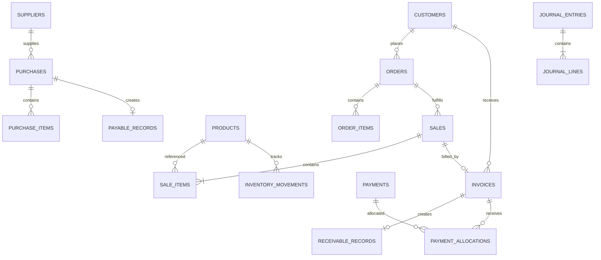

# DATABASE SCHEMA
## UMKM Manager

**Version:** 1.0  
**Status:** Draft – Proposed Database Design  
**Database:** IndexedDB  
**Database Wrapper:** Dexie.js (proposed)  
**Architecture:** Local-First Modular Monolith

---

# 1. Tujuan

Dokumen ini menetapkan struktur penyimpanan data UMKM Manager V1.

Database harus:
- Menyimpan seluruh data bisnis secara lokal.
- Mendukung fitur modular.
- Menjaga konsistensi transaksi.
- Mendukung transaksi tunai dan kredit.
- Mendukung pembayaran bertahap.
- Mendukung pesanan dan pengiriman sebagian.
- Mendukung stok dan perhitungan HPP.
- Mendukung backup dan restore.
- Menyimpan histori perubahan.
- Mencegah transaksi ganda.

Database harus dapat berkembang melalui migration tanpa menghilangkan data pengguna.

# 2. Prinsip Database

## 2.1 Unique Identity

Setiap entitas mempunyai ID unik yang tidak berubah.

Contoh:
- `productId`
- `customerId`
- `saleId`
- `invoiceId`
- `paymentId`
- `orderId`

Nama pelanggan atau produk tidak boleh digunakan sebagai primary key.

## 2.2 Master Data dan Transaction Data

**Master data:**
- Produk.
- Pelanggan.
- Pemasok.
- Karyawan.
- Akun keuangan.
- Profil usaha.

**Transaction data:**
- Penjualan.
- Pembelian.
- Pembayaran.
- Pesanan.
- Retur.
- Beban.
- Pergerakan stok.
- Jurnal keuangan.

Master data dapat diperbarui sesuai aturan. Data transaksi yang sudah diposting harus dikoreksi melalui mekanisme koreksi atau pembalikan, bukan dihapus sembarangan.

## 2.3 Historical Integrity

Transaksi harus mempertahankan snapshot informasi penting pada saat transaksi dibuat.

Contoh: jika harga produk berubah, nota penjualan lama tetap menampilkan harga ketika transaksi terjadi.

## 2.4 Financial Integrity

Saldo tidak boleh menjadi satu-satunya sumber kebenaran.

Nilai saldo harus dapat direkonsiliasi dengan transaksi keuangan yang membentuknya.

## 2.5 Money Precision

Nilai uang disimpan sebagai integer dalam satuan rupiah, bukan floating-point.

Contoh:

```ts
const price = 15000;
const total = 30000;
```

Jangan menggunakan:

```ts
const price = 15000.50;
```

Jika dukungan mata uang pecahan diperlukan di masa depan, presisi harus ditentukan secara eksplisit.

---

# 3. Database Overview

Tabel logis utama:

| Kelompok | Tabel |
|---|---|
| Core | businesses, settings, features |
| Finance | accounts, financial_entries, journal_entries, journal_lines |
| Products | products, product_units |
| Inventory | inventory_movements, stock_balances |
| Customers | customers |
| Suppliers | suppliers |
| Orders | orders, order_items |
| Sales | sales, sale_items |
| Invoices | invoices |
| Payments | payments, payment_allocations |
| Receivables | receivable_records |
| Payables | payable_records |
| Purchasing | purchases, purchase_items |
| Returns | returns, return_items |
| Expenses | expenses |
| Employees | employees, payroll_runs, payroll_items |
| Audit | audit_logs, correction_records |
| Reliability | idempotency_records, app_migrations |

Nama tabel merupakan nama logis. Implementasi aktual dapat menggabungkan atau memisahkan tabel selama relasi dan integritas tetap terjaga.

---

# 4. Core Tables

## 4.1 businesses

Menyimpan profil usaha.

| Field | Type | Description |
|---|---|---|
| id | string | Primary key |
| name | string | Nama usaha |
| ownerName | string | Nama pemilik, opsional |
| phone | string | Nomor telepon |
| address | string | Alamat |
| currency | string | Default IDR |
| createdAt | datetime | Waktu dibuat |
| updatedAt | datetime | Waktu diperbarui |

V1 direkomendasikan menggunakan satu profil usaha per instalasi.

## 4.2 app_settings

Menyimpan pengaturan aplikasi.

| Field | Type |
|---|---|
| id | string |
| key | string |
| value | JSON-compatible value |
| updatedAt | datetime |

Pengaturan harus divalidasi sebelum digunakan.

## 4.3 feature_settings

| Field | Type |
|---|---|
| featureId | string |
| enabled | boolean |
| version | number |
| enabledAt | datetime |
| disabledAt | datetime nullable |

Menonaktifkan fitur tidak menghapus tabel atau data terkait.

---

# 5. Finance Tables

## 5.1 accounts

Daftar akun keuangan.

| Field | Type |
|---|---|
| id | string |
| name | string |
| type | string |
| subtype | string |
| openingBalance | integer |
| isActive | boolean |
| createdAt | datetime |

Contoh jenis akun:
- CASH.
- BANK.
- RECEIVABLE.
- INVENTORY.
- PAYABLE.
- CAPITAL.
- REVENUE.
- EXPENSE.
- OWNER_WITHDRAWAL.
- CUSTOMER_ADVANCE.

Akun tidak boleh dihapus jika telah digunakan dalam transaksi.

## 5.2 journal_entries

Header pencatatan jurnal keuangan.

| Field | Type |
|---|---|
| id | string |
| entryNumber | string |
| sourceType | string |
| sourceId | string |
| transactionDate | datetime |
| postingDate | datetime |
| status | string |
| description | string |
| reversalOfEntryId | string nullable |
| createdAt | datetime |

Status:
- DRAFT.
- POSTED.
- REVERSED.

## 5.3 journal_lines

Detail debit dan kredit.

| Field | Type |
|---|---|
| id | string |
| journalEntryId | string |
| accountId | string |
| debit | integer |
| credit | integer |
| description | string |

Aturan jika full double-entry dipilih:
- Total debit harus sama dengan total kredit.
- Nilai debit dan kredit tidak boleh negatif.
- Satu baris tidak boleh memiliki debit dan kredit positif sekaligus.
- Jurnal POSTED tidak dapat diubah langsung.
- Koreksi dilakukan melalui jurnal pembalik atau koreksi.

**Catatan:** tabel jurnal disediakan sebagai rancangan untuk mendukung model double-entry. Apakah jurnal tersebut menjadi sumber pencatatan utama atau hasil posting dari transaction ledger masih menunggu keputusan pada FINANCIAL_LOGIC.md.

## 5.4 financial_entries

Catatan peristiwa keuangan untuk kebutuhan pelacakan transaksi dan rekonsiliasi.

| Field | Type |
|---|---|
| id | string |
| sourceType | string |
| sourceId | string |
| entryType | string |
| accountId | string |
| amount | integer |
| direction | string |
| transactionDate | datetime |
| status | string |
| createdAt | datetime |

Contoh:
- SALE_REVENUE.
- PAYMENT_RECEIVED.
- EXPENSE_RECORDED.
- OWNER_WITHDRAWAL.
- CAPITAL_CONTRIBUTION.
- INTERNAL_TRANSFER.
- RECEIVABLE_SETTLEMENT.

**Penting:** `financial_entries` dan `journal_entries` tidak boleh sama-sama menghasilkan dampak saldo secara independen. Model sumber kebenaran harus ditetapkan sebelum implementasi agar tidak terjadi pencatatan ganda.

---

# 6. Product Tables

## 6.1 products

| Field | Type |
|---|---|
| id | string |
| sku | string nullable |
| name | string |
| description | string nullable |
| category | string nullable |
| baseUnitId | string nullable |
| sellingPrice | integer |
| costMethod | string |
| isActive | boolean |
| createdAt | datetime |
| updatedAt | datetime |

Harga jual saat transaksi disimpan kembali dalam snapshot sale item.

## 6.2 product_units

Mendukung satuan produk.

| Field | Type |
|---|---|
| id | string |
| productId | string |
| unitName | string |
| conversionToBase | number |
| isBaseUnit | boolean |

Contoh:
- 1 dus = 12 botol.
- 1 pack = 6 unit.
- 1 unit = 1 unit dasar.

Konversi harus tervalidasi. Jangan mengasumsikan semua produk mempunyai satuan yang sama.

---

# 7. Inventory Tables

## 7.1 inventory_movements

Setiap perubahan stok harus mempunyai catatan pergerakan.

| Field | Type |
|---|---|
| id | string |
| productId | string |
| movementType | string |
| quantity | number |
| unitId | string |
| baseQuantity | number |
| unitCost | integer nullable |
| totalCost | integer nullable |
| sourceType | string |
| sourceId | string |
| transactionDate | datetime |
| createdAt | datetime |

Jenis:
- OPENING_STOCK.
- PURCHASE_RECEIPT.
- SALE_ISSUE.
- SALES_RETURN.
- PURCHASE_RETURN.
- STOCK_ADJUSTMENT.
- DAMAGED_STOCK.

Pergerakan stok harus dapat ditelusuri ke transaksi asal.

## 7.2 stock_balances

Tabel ringkasan stok untuk mempercepat pembacaan.

| Field | Type |
|---|---|
| productId | string |
| quantity | number |
| inventoryValue | integer |
| averageCost | integer nullable |
| updatedAt | datetime |

`stock_balances` adalah data turunan, bukan satu-satunya sumber kebenaran.

Sistem harus dapat membangun ulang saldo stok berdasarkan inventory movements.

---

# 8. Customer Tables

## 8.1 customers

| Field | Type |
|---|---|
| id | string |
| name | string |
| phone | string nullable |
| address | string nullable |
| notes | string nullable |
| creditLimit | integer nullable |
| isActive | boolean |
| createdAt | datetime |
| updatedAt | datetime |

Pencarian nama tidak boleh otomatis menggabungkan pelanggan.

## 8.2 customer_balances

Jika digunakan sebagai tabel ringkasan:

| Field | Type |
|---|---|
| customerId | string |
| receivableBalance | integer |
| advanceBalance | integer |
| updatedAt | datetime |

Saldo harus dapat direkonsiliasi dengan invoice, payment allocations, credit notes, dan jurnal terkait.

---

# 9. Supplier Tables

## 9.1 suppliers

| Field | Type |
|---|---|
| id | string |
| name | string |
| phone | string nullable |
| address | string nullable |
| notes | string nullable |
| isActive | boolean |
| createdAt | datetime |
| updatedAt | datetime |

## 9.2 supplier_balances

| Field | Type |
|---|---|
| supplierId | string |
| payableBalance | integer |
| updatedAt | datetime |

Saldo merupakan data ringkasan yang harus dapat direkonstruksi.

---

# 10. Order Tables

## 10.1 orders

| Field | Type |
|---|---|
| id | string |
| orderNumber | string |
| customerId | string nullable |
| customerNameSnapshot | string |
| orderDate | datetime |
| requestedDeliveryDate | datetime nullable |
| status | string |
| subtotal | integer |
| discount | integer |
| total | integer |
| notes | string nullable |
| createdAt | datetime |
| updatedAt | datetime |

Status:
- WAITING_CONFIRMATION.
- PROCESSING.
- READY.
- SHIPPED.
- COMPLETED.
- CANCELLED.

Status pembayaran disimpan terpisah.

## 10.2 order_items

| Field | Type |
|---|---|
| id | string |
| orderId | string |
| productId | string nullable |
| productNameSnapshot | string |
| quantityOrdered | number |
| quantityFulfilled | number |
| unitPrice | integer |
| discount | integer |
| lineTotal | integer |

Pesanan yang belum dipenuhi tidak boleh otomatis mengurangi stok atau mengakui pendapatan penjualan.

Pengiriman sebagian harus memiliki catatan fulfillment terpisah atau struktur ekuivalen agar riwayat penyerahan dapat dilacak.

---

# 11. Sales Tables

## 11.1 sales

| Field | Type |
|---|---|
| id | string |
| saleNumber | string |
| customerId | string nullable |
| customerNameSnapshot | string nullable |
| orderId | string nullable |
| saleDate | datetime |
| subtotal | integer |
| discount | integer |
| additionalCharges | integer |
| total | integer |
| status | string |
| createdAt | datetime |

Status:
- DRAFT.
- POSTED.
- PARTIALLY_RETURNED.
- RETURNED.
- REVERSED.

## 11.2 sale_items

| Field | Type |
|---|---|
| id | string |
| saleId | string |
| productId | string nullable |
| productNameSnapshot | string |
| quantity | number |
| unitId | string nullable |
| baseQuantity | number |
| unitPrice | integer |
| unitCostSnapshot | integer nullable |
| discount | integer |
| lineTotal | integer |
| cogs | integer nullable |

Snapshot penting agar perubahan master produk tidak mengubah transaksi lama.

---

# 12. Invoice Tables

## 12.1 invoices

| Field | Type |
|---|---|
| id | string |
| invoiceNumber | string |
| saleId | string |
| customerId | string nullable |
| issueDate | datetime |
| dueDate | datetime nullable |
| subtotal | integer |
| discount | integer |
| total | integer |
| paymentStatus | string |
| createdAt | datetime |

Invoice harus memiliki hubungan yang jelas dengan transaksi penjualan.

Satu penjualan tidak boleh menciptakan dua invoice aktif yang menyebabkan piutang terhitung ganda, kecuali sistem mendukung pembagian tagihan secara eksplisit.

Nota adalah representasi transaksi, bukan transaksi keuangan kedua.

---

# 13. Payment Tables

## 13.1 payments

| Field | Type |
|---|---|
| id | string |
| paymentNumber | string |
| paymentType | string |
| direction | string |
| amount | integer |
| paymentMethod | string |
| accountId | string |
| paymentDate | datetime |
| referenceNumber | string nullable |
| notes | string nullable |
| status | string |
| createdAt | datetime |

Jenis pembayaran:
- CUSTOMER_PAYMENT.
- CUSTOMER_ADVANCE.
- SUPPLIER_PAYMENT.
- CUSTOMER_REFUND.
- OTHER_RECEIPT.
- OTHER_DISBURSEMENT.

## 13.2 payment_allocations

| Field | Type |
|---|---|
| id | string |
| paymentId | string |
| invoiceId | string nullable |
| payableRecordId | string nullable |
| allocatedAmount | integer |
| allocationType | string |
| createdAt | datetime |

Tabel ini memungkinkan:
- Satu invoice dibayar beberapa kali.
- Satu pembayaran dialokasikan ke beberapa invoice.
- Pembayaran tidak menciptakan penjualan baru.

Aturan alokasi harus memastikan total alokasi tidak melebihi jumlah pembayaran atau saldo tagihan yang dapat dibayar.

Kelebihan pembayaran harus dicatat sebagai saldo pelanggan atau uang muka berdasarkan kebijakan yang disetujui.

---

# 14. Receivable Tables

## 14.1 receivable_records

| Field | Type |
|---|---|
| id | string |
| invoiceId | string |
| customerId | string nullable |
| originalAmount | integer |
| outstandingAmount | integer |
| dueDate | datetime nullable |
| status | string |
| createdAt | datetime |
| updatedAt | datetime |

Nilai piutang harus dapat direkonsiliasi:

`Original Amount - Allocated Payments - Credits + Adjustments = Outstanding Amount`

Jangan membuat piutang dari pesanan yang belum diserahkan.

---

# 15. Purchasing and Payables Tables

## 15.1 purchases

| Field | Type |
|---|---|
| id | string |
| purchaseNumber | string |
| supplierId | string nullable |
| supplierNameSnapshot | string nullable |
| purchaseDate | datetime |
| status | string |
| subtotal | integer |
| discount | integer |
| total | integer |
| createdAt | datetime |

## 15.2 purchase_items

| Field | Type |
|---|---|
| id | string |
| purchaseId | string |
| productId | string nullable |
| productNameSnapshot | string |
| quantity | number |
| unitCost | integer |
| lineTotal | integer |

Penerimaan barang perlu direkam secara terpisah dari pembuatan pesanan pembelian jika diperlukan.

## 15.3 payable_records

| Field | Type |
|---|---|
| id | string |
| purchaseId | string |
| supplierId | string nullable |
| originalAmount | integer |
| outstandingAmount | integer |
| dueDate | datetime nullable |
| status | string |
| createdAt | datetime |

Pembayaran utang tidak boleh mengakui biaya pembelian untuk kedua kalinya.

---

# 16. Return Tables

## 16.1 returns

| Field | Type |
|---|---|
| id | string |
| returnNumber | string |
| sourceSaleId | string |
| customerId | string nullable |
| returnDate | datetime |
| reason | string |
| refundAmount | integer |
| status | string |
| createdAt | datetime |

## 16.2 return_items

| Field | Type |
|---|---|
| id | string |
| returnId | string |
| saleItemId | string |
| quantity | number |
| condition | string |
| restock | boolean |
| returnValue | integer |

Jumlah retur kumulatif tidak boleh melebihi jumlah barang yang terjual setelah memperhitungkan retur sebelumnya.

Barang rusak tidak otomatis masuk stok layak jual.

---

# 17. Expense Tables

## 17.1 expenses

| Field | Type |
|---|---|
| id | string |
| expenseNumber | string |
| category | string |
| description | string |
| amount | integer |
| expenseDate | datetime |
| paymentId | string nullable |
| status | string |
| createdAt | datetime |

Pengeluaran pribadi pemilik tidak boleh disimpan sebagai beban operasional.

Pengeluaran yang belum dibayar dapat membutuhkan kewajiban terpisah jika model akuntansi mendukungnya.

---

# 18. Employee and Payroll Tables

## 18.1 employees

| Field | Type |
|---|---|
| id | string |
| name | string |
| phone | string nullable |
| position | string nullable |
| baseSalary | integer |
| employmentStatus | string |
| createdAt | datetime |

## 18.2 payroll_runs

| Field | Type |
|---|---|
| id | string |
| payrollNumber | string |
| periodStart | datetime |
| periodEnd | datetime |
| totalGross | integer |
| totalDeductions | integer |
| totalNet | integer |
| status | string |
| createdAt | datetime |

## 18.3 payroll_items

| Field | Type |
|---|---|
| id | string |
| payrollRunId | string |
| employeeId | string |
| grossSalary | integer |
| deductions | integer |
| netSalary | integer |
| paymentStatus | string |
| paymentId | string nullable |

Penggajian yang sudah diakui sebagai beban tidak boleh diakui lagi sebagai beban ketika pembayaran dilakukan.

---

# 19. Audit and Reliability Tables

## 19.1 audit_logs

| Field | Type |
|---|---|
| id | string |
| entityType | string |
| entityId | string |
| action | string |
| beforeSnapshot | JSON |
| afterSnapshot | JSON |
| reason | string nullable |
| timestamp | datetime |

Menyimpan:
- Pembuatan data.
- Perubahan yang diizinkan.
- Pembatalan.
- Koreksi.
- Restore.
- Aktivasi/nonaktivasi fitur.

## 19.2 correction_records

| Field | Type |
|---|---|
| id | string |
| entityType | string |
| entityId | string |
| correctionType | string |
| reason | string |
| reversalEntryId | string nullable |
| createdAt | datetime |

Koreksi transaksi yang sudah diposting harus dapat ditelusuri.

## 19.3 idempotency_records

| Field | Type |
|---|---|
| id | string |
| operationKey | string |
| operationType | string |
| resultEntityId | string |
| status | string |
| createdAt | datetime |

Digunakan untuk mencegah pemrosesan perintah yang sama lebih dari sekali.

## 19.4 app_migrations

| Field | Type |
|---|---|
| version | number |
| description | string |
| appliedAt | datetime |

Digunakan untuk melacak perubahan struktur database.

---

# 20. Entity Relationships

Relasi utama:



Relasi aktual harus mendukung:
- Pengiriman sebagian.
- Pembayaran sebagian.
- Retur sebagian.
- Pembayaran lintas invoice.
- Koreksi dan reversal.

---

# 21. Data Integrity Constraints

Wajib diterapkan:

1. ID setiap entitas unik.
2. Nomor transaksi tidak boleh duplikat.
3. Nilai uang tidak boleh negatif kecuali jenis transaksi secara eksplisit mengizinkannya.
4. Kuantitas harus divalidasi.
5. Referensi antarentitas harus valid.
6. Invoice harus terhubung dengan sumber transaksi.
7. Pembayaran harus memiliki akun dan metode yang valid.
8. Pembayaran tidak boleh menciptakan pendapatan ganda.
9. Penjualan tidak boleh mengurangi stok dua kali.
10. Retur tidak boleh melebihi jumlah terjual.
11. Saldo piutang dan utang harus dapat direkonsiliasi.
12. Saldo stok harus dapat dibangun ulang dari movement.
13. Jurnal double-entry harus seimbang jika model tersebut dipilih.
14. Transaksi POSTED tidak boleh dihapus langsung.
15. Restore harus memvalidasi semua relasi.
16. Menonaktifkan modul tidak boleh menghapus histori.

---

# 22. IndexedDB Index Recommendations

Index awal yang direkomendasikan:

| Table | Index |
|---|---|
| products | name, sku, isActive |
| customers | name, phone, isActive |
| suppliers | name, isActive |
| sales | saleNumber, saleDate, customerId, status |
| invoices | invoiceNumber, saleId, customerId, dueDate |
| payments | paymentNumber, paymentDate, status |
| orders | orderNumber, customerId, status, orderDate |
| inventory_movements | productId, transactionDate, sourceId |
| purchases | purchaseNumber, supplierId, purchaseDate |
| audit_logs | entityType, entityId, timestamp |

Index majemuk perlu disesuaikan dengan query aktual dan kemampuan IndexedDB/Dexie.

---

# 23. Database Migration

Setiap perubahan skema harus mempunyai versi migration.

Aturan:
- Migration harus terurut.
- Migration tidak boleh menghapus data tanpa persetujuan.
- Migration harus dapat diuji pada salinan database.
- Backup disarankan sebelum migration berisiko.
- Migration gagal tidak boleh meninggalkan database dalam kondisi setengah berubah.
- Versi aplikasi dan versi database harus dapat diperiksa.

Contoh:

```ts
db.version(1).stores({
  products: 'id, name, sku',
  customers: 'id, name, phone',
  sales: 'id, saleNumber, saleDate'
});
```

Kode di atas hanya ilustrasi awal. Skema produksi harus mencakup seluruh tabel dan indeks yang sudah disetujui.

---

# 24. Open Decisions

| ID | Keputusan | Status |
|---|---|---|
| DB-001 | Full double-entry atau event ledger | Open |
| DB-002 | Struktur pembayaran lintas invoice | Proposed |
| DB-003 | Dukungan pecahan kuantitas | Open |
| DB-004 | Kebijakan stok negatif | Open |
| DB-005 | Metode HPP | Menunggu persetujuan |
| DB-006 | Pengelolaan pajak | Open |
| DB-007 | Penguncian periode akuntansi | Open |
| DB-008 | Strategi penghapusan data master | Open |
| DB-009 | Kebijakan retensi audit logs | Open |

OpenCode tidak boleh menetapkan keputusan tersebut sendiri jika berdampak pada data historis atau hasil laporan keuangan.

---

# 25. Database Acceptance Criteria

Database dinyatakan siap implementasi apabila:

- Seluruh entitas inti telah ditentukan.
- Hubungan transaksi sudah jelas.
- Data historis memiliki snapshot.
- Pembayaran dan alokasi mendukung pembayaran sebagian.
- Inventory movements dapat membangun ulang saldo stok.
- Piutang dan utang dapat direkonsiliasi.
- Idempotency tersedia.
- Audit trail tersedia.
- Migration strategy tersedia.
- Backup dan restore dapat mempertahankan relasi.
- Tidak ada dua sumber kebenaran yang saling bertentangan untuk saldo keuangan.

---

**Document Status:** Draft – Proposed Database Design.  
**Implementation Status:** Not Authorized by This Document Alone.
# DATABASE_SCHEMA.md

**UMKM Manager — Database Schema**  
Version: 1.1  
Status: Draft – Audit Revision  
Approval: Pending Product Owner Approval

## 1. Tujuan dan prinsip

Database menggunakan penyimpanan lokal berbasis IndexedDB. Dexie.js tetap menjadi usulan wrapper database.

Prinsip:
- ID internal unik dan stabil.
- Relasi antartabel menggunakan ID, bukan nama.
- Data transaksi historis tidak bergantung pada nama master data yang dapat berubah.
- Transaksi keuangan dan stok harus konsisten.
- Operasi posting harus idempotent.
- Koreksi mempertahankan referensi transaksi asal.
- Skema mendukung migrasi versi.
- Tidak ada sinkronisasi cloud otomatis pada V1.

## 2. Sumber kebenaran keuangan

**Usulan – Menunggu Persetujuan:** `journal_entries` dan `journal_lines` menjadi sumber kebenaran saldo keuangan.

Tabel `financial_entries` tidak boleh menjadi sumber saldo independen. Jika dipertahankan, fungsinya hanya sebagai catatan/proyeksi untuk kebutuhan tampilan atau pencarian dan harus dapat direkonstruksi dari sumber transaksi/jurnal.

Tidak boleh menghitung saldo dari `financial_entries` dan jurnal secara bersamaan.

## 3. Tabel inti

### `business_profile`
- `id`
- `name`
- `address`
- `phone`
- `email`
- `created_at`
- `updated_at`

**Usulan V1:** satu profil usaha per instalasi.

### `accounts`
- `id`
- `code`
- `name`
- `account_type`
- `parent_id`
- `is_system`
- `is_active`

Jenis akun mencakup aset, kewajiban, ekuitas, pendapatan, dan beban.

### `journal_entries`
- `id`
- `transaction_date`
- `posted_at`
- `reference_type`
- `reference_id`
- `description`
- `status`
- `reversal_of_id`
- `idempotency_key`
- `created_at`

### `journal_lines`
- `id`
- `journal_entry_id`
- `account_id`
- `debit_minor`
- `credit_minor`
- `currency`
- `description`

Aturan:
- Total debit harus sama dengan total kredit.
- Nilai uang menggunakan integer satuan terkecil atau representasi desimal presisi yang tervalidasi.
- Jurnal yang telah diposting tidak diedit langsung.
- Koreksi memakai jurnal reversal/koreksi.

### `cash_accounts`
- `id`
- `name`
- `account_id`
- `opening_balance`
- `is_active`

### `financial_transactions`
Jika dibutuhkan sebagai header transaksi bisnis:
- `id`
- `type`
- `transaction_date`
- `status`
- `reference_number`
- `description`
- `idempotency_key`
- `created_at`

Tabel ini bukan sumber saldo; dampak keuangan harus ditelusuri melalui jurnal.

## 4. Produk dan persediaan

### `products`
- `id`
- `name`
- `sku`
- `category_id`
- `base_unit_id`
- `sale_price`
- `is_active`
- `created_at`
- `updated_at`

### `product_units`
- `id`
- `product_id`
- `unit_name`
- `conversion_to_base`
- `is_base_unit`

Konversi harus eksplisit dan tervalidasi.

### `inventory_movements`
- `id`
- `product_id`
- `movement_type`
- `quantity`
- `unit_cost`
- `total_cost`
- `reference_type`
- `reference_id`
- `movement_date`
- `idempotency_key`

### `stock_balances`
- `product_id`
- `quantity`
- `updated_at`

`stock_balances` merupakan proyeksi/cache yang dapat direkonsiliasi dengan `inventory_movements`, bukan histori independen.

**Usulan – Menunggu Persetujuan:** moving weighted average dan larangan stok negatif secara default.

Jika menggunakan moving weighted average, simpan nilai biaya dan kuantitas dengan presisi yang cukup untuk mencegah kesalahan pembulatan.

## 5. Pelanggan dan pemasok

### `customers`
- `id`
- `name`
- `phone`
- `address`
- `notes`
- `credit_limit`
- `is_active`
- `created_at`
- `updated_at`

Nama yang mirip tidak otomatis digabung.

### `suppliers`
- `id`
- `name`
- `phone`
- `address`
- `notes`
- `is_active`

## 6. Pesanan dan pemenuhan

### `orders`
- `id`
- `order_number`
- `customer_id`
- `order_date`
- `operational_status`
- `notes`
- `created_at`

### `order_items`
- `id`
- `order_id`
- `product_id`
- `description_snapshot`
- `quantity_ordered`
- `unit_price`
- `discount`
- `unit_id`

### `order_fulfillments`
- `id`
- `order_id`
- `fulfillment_date`
- `status`
- `notes`

### `order_fulfillment_items`
- `id`
- `fulfillment_id`
- `order_item_id`
- `quantity_fulfilled`

Tabel pemenuhan mendukung pemenuhan sebagian jika kebijakan tersebut disetujui.

## 7. Penjualan dan invoice

### `sales`
- `id`
- `sale_number`
- `order_id`
- `fulfillment_id`
- `customer_id`
- `sale_date`
- `subtotal`
- `discount_total`
- `additional_charges`
- `grand_total`
- `status`
- `idempotency_key`

### `sale_items`
- `id`
- `sale_id`
- `product_id`
- `description_snapshot`
- `quantity`
- `unit_id`
- `unit_price`
- `discount`
- `cost_snapshot`
- `line_total`

### `invoices`
- `id`
- `invoice_number`
- `sale_id`
- `customer_id`
- `issue_date`
- `due_date`
- `total_amount`
- `status`
- `customer_snapshot`

Invoice menyimpan snapshot informasi yang diperlukan untuk mempertahankan histori.

## 8. Pembayaran dan alokasi

### `payments`
- `id`
- `payment_number`
- `customer_id`
- `payment_date`
- `amount`
- `payment_method`
- `status`
- `idempotency_key`
- `notes`

### `payment_allocations`
- `id`
- `payment_id`
- `invoice_id`
- `allocated_amount`
- `created_at`

**Usulan – Menunggu Persetujuan:** satu pembayaran dapat dialokasikan ke beberapa invoice.

Validasi:
- Jumlah alokasi tidak melebihi pembayaran.
- Alokasi tidak melebihi saldo invoice.
- Pembayaran yang belum dialokasikan tetap tercatat sebagai saldo kredit/kewajiban, bukan pendapatan.

### `receivable_records`
Jika diperlukan sebagai proyeksi:
- `id`
- `invoice_id`
- `original_amount`
- `outstanding_amount`
- `status`

Saldo piutang harus dapat direkonsiliasi dari invoice dan alokasi pembayaran. Tabel proyeksi tidak boleh menjadi sumber kedua yang berdiri sendiri.

## 9. Pembelian dan utang

### `purchases`
- `id`
- `supplier_id`
- `purchase_date`
- `total_amount`
- `status`

### `purchase_items`
- `id`
- `purchase_id`
- `product_id`
- `quantity`
- `unit_cost`
- `line_total`

### `payable_records`
- `id`
- `purchase_id`
- `original_amount`
- `outstanding_amount`
- `status`

### `supplier_payments`
- `id`
- `supplier_id`
- `payment_date`
- `amount`
- `payment_method`
- `idempotency_key`

### `supplier_payment_allocations`
- `id`
- `supplier_payment_id`
- `payable_id`
- `allocated_amount`

## 10. Retur dan koreksi

### `returns`
- `id`
- `original_sale_id`
- `return_date`
- `reason`
- `status`
- `refund_amount`

### `return_items`
- `id`
- `return_id`
- `sale_item_id`
- `quantity`
- `condition`
- `restock_quantity`
- `restock_status`

### `correction_records`
- `id`
- `original_transaction_type`
- `original_transaction_id`
- `correction_type`
- `reason`
- `created_at`

## 11. Biaya dan payroll

Tabel yang direncanakan:
- `expenses`
- `expense_categories`
- `employees`
- `payroll_runs`
- `payroll_items`
- `employee_advances`

Setiap transaksi yang berdampak keuangan harus memiliki referensi jurnal.

## 12. Audit, idempotensi, dan migrasi

### `audit_logs`
- `id`
- `entity_type`
- `entity_id`
- `action`
- `before_data`
- `after_data`
- `reason`
- `created_at`

### `idempotency_records`
- `idempotency_key`
- `operation_type`
- `result_reference`
- `status`
- `created_at`

### `schema_migrations`
- `version`
- `applied_at`
- `description`

Migrasi harus memiliki prosedur validasi dan pemulihan.

## 13. Aturan integritas

1. Foreign key/logical references harus tervalidasi.
2. Nomor invoice dan nomor transaksi unik.
3. Jurnal harus seimbang.
4. Pembayaran tidak boleh dialokasikan melebihi nilai yang tersedia.
5. Retur tidak boleh melebihi kuantitas bersih yang terjual.
6. Stok harus dapat direkonsiliasi dari pergerakan.
7. Saldo piutang harus dapat direkonsiliasi dari invoice dan pembayaran.
8. Semua operasi terkait posting harus atomik atau memiliki mekanisme pemulihan yang ekuivalen.
9. Data historis tidak boleh hilang ketika modul dinonaktifkan.

## 14. Keputusan terbuka

- Model double-entry sebagai sumber kebenaran.
- Struktur final akun dan jurnal.
- Metode HPP.
- Kebijakan stok negatif.
- Alokasi pembayaran lintas invoice.
- Pembayaran pemasok berlebih.
- Presisi kuantitas dan uang.
- Penguncian periode.
- Retensi audit log.
- Perlakuan pajak.
- Penyusutan aset.
- Strategi migrasi dan pemulihan.

## 15. Batasan

Ini adalah rancangan skema, bukan migrasi database final. Jangan membuat atau mengubah database produksi sebelum keputusan terkait disetujui dan desain direview.